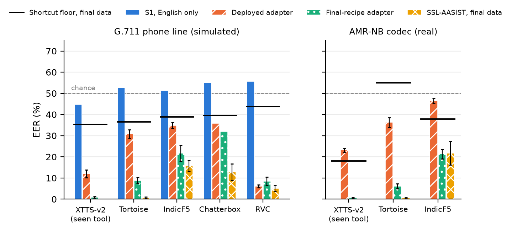
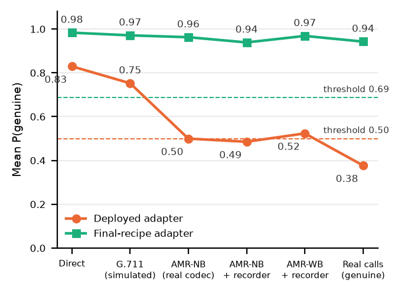

# Recording Domain, Not Code-Mixing: Closing the Generalisation Gap of Audio Deepfake Detection on Hindi–English Telephone Speech

[](https://github.com/Mounika-Reddy-0802/codemix-deepfake-detection/actions/workflows/ci.yml)


An audio deepfake detector trained on English is quietly worse at Hinglish. This
project **measures that gap under a channel-matched telephony protocol**, closes
most of it with LoRA and more genuine voices, and runs it live: on a browser call a cloned
voice raises a warning on the receiver's dashboard, and the telephone carrier, built to
beep in the receiver's ear and send an SMS, is implemented but not yet run on live numbers.
Recorded real mobile calls were scored offline through the same path.

> **Status: Week 14 — the final recipe, a larger encoder, and a first test on real phone calls.**
>
> An English-trained detector (0.85% EER on English) reaches **58.42%** on Hindi–English
> speech over a phone line; it rejects real speakers, calling **94.8%** of clean genuine
> Hindi–English clips fake; a
> language-controlled test on 183 unseen speakers shows the gap follows the **recording
> domain, not the code-mixing**. LoRA adapters (1.13% of the weights) bring the phone-line
> error to **3.27 ± 1.17%** over five seeds. The **final recipe**, the same adapter trained on
> 248 genuine speakers (with seen-tool clones of the new ones) through both the simulated G.711 line and the real AMR-NB codec, cuts
> unseen Tortoise clones over AMR-NB from **36.3% to 6.0%** and beats its shortcut floor in
> every seed on every set (three of those floors are weak bars). A larger encoder (SSL-AASIST) trained on the same data reaches
> **0.5%** there and **12.9%** on Chatterbox. Still open, and stated: IndicF5 (16–22%),
> spontaneous speech, and English over the phone line.
>
> **Real calls (pilot, 30 calls, three speakers):** over a mobile network, the deployed model
> takes every replayed call and every live call of two speakers of three to "likely cloned"
> (for the speakers it fails on, the real mobile codec is the largest step); the final recipe
> warns 3 of 12 genuine live calls (all one speaker's) and takes 5 of 6 XTTS-v2 clone calls
> to "likely cloned", but none of 6 Chatterbox calls (it cautions one); the larger encoder
> (SSL-AASIST, one checkpoint at its own dev-chosen operating point) warns 1 of 12 genuine live
> calls and takes all 6 XTTS-v2 calls and 1 of 6 Chatterbox calls to "likely cloned"
> ([real_calls_v1](docs/results/real_calls_v1.md); the call chain, stage by stage:
> [`paper/figures/real_call_chain.pdf`](paper/figures/real_call_chain.pdf)).

---

## Architecture

The pipeline is a vertical chain in which each stage builds on those above it, and two firewalls (described under the diagram) cut across
all of them.

```mermaid
flowchart TD
    A["1 · CORPORA — L<br/>ASVspoof 2019 LA (English)<br/>MUCS Hindi-English · HiACC-adult"]
    A --> B["2 · CORPUS INDEX — L<br/>56,143 clips · real Kaldi speaker ids<br/>HiACC child audio quarantined on extract"]
    B --> C["3 · SPEAKER POOLS — FROZEN — SK<br/>25 train · 10 adaptation · 15 eval<br/>sha256 f57e0d85… · carved before any clone was made"]
    C --> D["4 · SPOOF GENERATION — SK<br/>XTTS-v2 clones + RVC conversions = seen attacks<br/>Tortoise, IndicF5, Chatterbox = held out, never trained on"]
    D --> E["5 · TELEPHONY CHANNEL — L<br/>8 kHz · G.711 μ-law / AMR-NB · SNR mixing<br/>G.711 verified by measurement and by ear; AMR-NB by measurement"]
    E --> F["6 · DETECTOR — M<br/>wav2vec2-base + attentive stats pooling + MLP"]
    F --> G["7 · STAGE 1 — ENGLISH ONLY — M<br/>ASVspoof 2019 LA eval<br/>0.85% EER"]
    G --> H["8 · GAP MATRIX — M<br/>same detector on code-mixed Hinglish<br/>48.21% EER clean · 58.42% over the phone line"]
    H --> I["9 · STAGE 2 — LoRA ADAPTATION — M<br/>1.13% of parameters · phone line 3.27 ± 1.17% (5 seeds)<br/>final recipe: 248 voices + the real AMR-NB codec"]
    I --> J["10 · LIVE CALL SYSTEM — SK<br/>streaming inference over WebRTC · Twilio built, not yet on live numbers<br/>warning to the receiver only · real mobile calls scored"]

    style A fill:#1f3a5f,stroke:#4a90d9,color:#fff
    style B fill:#1f3a5f,stroke:#4a90d9,color:#fff
    style C fill:#1f3a5f,stroke:#4a90d9,color:#fff
    style D fill:#2d4a2b,stroke:#6aa84f,color:#fff
    style E fill:#2d4a2b,stroke:#6aa84f,color:#fff
    style F fill:#4a3a1f,stroke:#d9a441,color:#fff
    style G fill:#4a3a1f,stroke:#d9a441,color:#fff
    style H fill:#5f1f1f,stroke:#d94a4a,color:#fff
    style I fill:#4a3a1f,stroke:#d9a441,color:#fff
    style J fill:#3f1f5f,stroke:#9a4ad9,color:#fff
```



**Two firewalls run through every stage, enforced by tests rather than by discipline:**

1. **Stage-1 trains on English only.** That is what makes the gap a measurement of
   real generalisation rather than an artefact of mixed training data.
2. **Speaker pools never overlap** — including the voices that get cloned. A clone
   of speaker X counts as speaker X, so disjointness holds across bonafide *and*
   spoof.

`tests/test_config_guard.py` (every committed training config, on the rows it would
really train on) and `tests/test_splits.py` (the checks themselves, on synthetic
manifests) run before every training launch and fail the build if either is broken.

---

## The problem

Anti-spoofing detectors are trained and benchmarked overwhelmingly on English. Real
fraud calls in India are **code-mixed** — Hindi and English alternating *inside a
single utterance* — and arrive over an 8 kHz telephone channel that destroys exactly
the high-frequency artefacts most detectors rely on.

Two shifts stack: **language** and **channel**. Most published EERs measure neither;
the telephony benchmarks are English, and we found no study of Hindi–English code-mixing
over a phone line. This project measures both, in the condition a detector would actually be
deployed in. One result changed the question itself: holding speaker and recording fixed,
the English-trained detector rejects genuine English at least as often as code-mixed speech, so what
it fails on is the **recording domain** that code-mixed phone speech carries, not the
language mix.

---

## Results — what is actually measured

Every number below comes from a real run on real data and is reproducible from
[Reproduce](#reproduce) (the week-12 to week-14 runs are the `notebooks/kaggle_w12_*`, `kaggle_w13_*` and `kaggle_w14_*`
notebooks). **The newest results come first**; sections 1–5
are the pre-normalisation numbers, kept as the record of how we got here.

### Week 14 — what a caller meets

**Whole calls, not clips.** Test clips replayed through the live scoring path and stitched
into 60 s calls, with the final recipe's operating point chosen on the dev set only
([live_final_recipe_v1](docs/results/live_final_recipe_v1.md)):

| 60 s calls | Deployed S2 | Final recipe |
|---|---|---|
| Genuine read speech, 60 new speakers: warned | 44% | **0%** |
| Tortoise (CM04) calls caught | 33% | **100%** |
| XTTS and RVC calls caught | 100% | 100% |
| IndicF5 / Chatterbox calls caught | 67% / 33% | 50% / 17% |
| **Genuine spontaneous calls (HiACC): warned** | **100%** | **100%** |

- **The final recipe can run in the live system** (the deployed adapter is still the
  default): `DFD_CHECKPOINT` at its checkpoint and
  `DFD_THRESHOLD_FILE=configs/threshold_final.yaml` ([live_call/README](live_call/README.md)).
- **English**: the final recipe rarely calls genuine English fake but catches only 26% of
  English fakes (13.44% EER clean) ([english_final_v1](docs/results/english_final_v1.md)).
- **The larger encoder can run live** (1.14 s per 2 s window hop on two CPU threads, 69 ms on
  a GPU), and one of its trainings calls only 5.8% of spontaneous speech fake, another 46.7%:
  a lead, not a fix ([encoder_spontaneous_v1](docs/results/encoder_spontaneous_v1.md)).
- **One overview figure** of every main system against every attack tool, both channels:
  `paper/figures/final_overview.pdf`. **Model card** (draft, not published):
  [MODEL_CARD](docs/MODEL_CARD.md).

  

- **Real phone calls (pilot)**: with written consent and the mentor's approval, the team called
  each other over a mobile network; genuine calls, our own readings and clones of our voices
  replayed into calls, recorded on the receiving handset and scored through the live path
  ([PROTOCOL](docs/real_calls/PROTOCOL.md), [real_calls_v1](docs/results/real_calls_v1.md)).
  Over 30 calls from three speakers, the deployed model takes every replayed call and every
  live call of two speakers of three to "likely cloned"; the final recipe warns 3 of 12
  genuine live calls (all one speaker's) and takes 5 of 6 XTTS-v2 clone calls but none of 6
  Chatterbox calls to "likely cloned". **The larger encoder does better on the same calls**:
  SSL-AASIST, retrained on Kaggle so its weights could be kept and given its own operating point
  on the same dev clips by the same rule, warns 1 of 12 genuine live calls (none "likely
  cloned"), takes all 6 XTTS-v2 calls to "likely cloned" (four of them 10-14 s in) and catches 1
  Chatterbox call and cautions 2. It is one checkpoint, the weakest of six trainings on
  Chatterbox offline (21.2% EER against 8.2-18.3%). On held-out 60 s calls at the
  same operating point it warns 11 of 41 genuine spontaneous (HiACC) calls, where the final recipe
  warns all 41, but trainings of this encoder differ on spontaneous speech, so a second checkpoint
  has to agree first.
  Rebuilding the call chain on our direct recordings
  shows where the deployed model breaks: over six readings its mean P(genuine) falls from 0.75
  through the simulated line to **0.50 through the real AMR-NB codec**, its threshold, the
  largest step for the two speakers it fails on, while the final recipe stays at 0.82-1.00
  for every reading. Every replay recording was checked against the file played into it
  before scoring (18 of 18 match).

  

- **Conference paper** (`paper/short/main.tex`) in the IEEE two-column format; its page
  count is checked in Overleaf, since the laptop has no LaTeX.
- **Weights package** for the release decision: safetensors, config, model card, checksums,
  verified identical to the checkpoint ([release](docs/release.md)).

### Week 13 — the final recipe, a larger encoder, and a third unseen tool

**More voices and a real codec close most of the gap.** The final recipe trains the same
LoRA adapter on 248 genuine speakers (with seen-tool clones of the new ones) instead of 21, every clip over both the simulated
G.711 line and the real AMR-NB mobile codec. Five seeds, paired with the deployed recipe
([final_recipe_v1](docs/results/final_recipe_v1.md)); no unseen-tool audio in training.

| EER (%), five seeds | Deployed S2 | Final recipe | Larger encoder (SSL-AASIST) |
|---|---|---|---|
| New speakers, Tortoise, G.711 | 30.8 | 8.8 | **0.7** |
| New speakers, Tortoise, AMR-NB | 36.3 | 6.0 | **0.5** |
| CM04 Tortoise, G.711 | 36.2 | 17.7 | **1.8** |
| IndicF5, G.711 | 34.9 | 21.7 | **15.8** |
| Chatterbox (third unseen tool) | 35.8 (one seed) | 32.0 (one seed) | **12.9** |
| RVC test half | 6.1 | 8.5 | **5.2** |
| Genuine called fake | 2.4 | 0.5 | **0.3** |

- **Both final systems beat their shortcut floor in every seed on every set**, unseen
  tools included (new-speaker Tortoise 8.8% against a floor of 36.5%). Three of those
  floors are above chance, and the report marks them as weak bars
  ([floor_final_v1](docs/results/floor_final_v1.md)).
- **The larger encoder** (XLS-R 300M, about three times our encoder) is better than the
  adapter in every seed on eight of eleven sets (exact p = 0.008 on seven)
  ([ssl_vs_adapter_v1](docs/results/ssl_vs_adapter_v1.md)). Its cost on a live call was
  measured in week 14 (above); the live system still runs the deployed S2.
- **Chatterbox** (CM09, 525 clips) is the adapters' hardest tool (SSL-AASIST does better on
  it than on IndicF5); IndicF5 stays at 15.8-21.8% for
  both final systems ([chatterbox scores](experiments/results/cm09_v1)).
- **Outside baselines zero-shot fail the same way:** AASIST rejects 82.3% and SSL-AASIST
  73.1% of genuine Hindi-English speech ([w13_runs_v1](docs/results/w13_runs_v1.md),
  [ssl_aasist_v1](docs/results/ssl_aasist_v1.md)).

### Week 13 — is it the code-mixing? New speakers, a second unseen tool, a real codec

**The gap follows the recording, not the language mix.** A language-controlled set holds
speaker and recording fixed: 183 unseen speakers, each with all-English, all-Hindi and
mixed clips from the same lectures. The English-only S1 rejects their genuine English
at least as often as their mixed speech, and the Code-Mixing Index does not predict its score
([language_control_v1](docs/results/language_control_v1.md),
[cmi_bands_v1](docs/results/cmi_bands_v1.md)).

| False alarms (%) | English | Hindi | Mixed |
|---|---|---|---|
| S1, clean | 84.3 | 85.2 | 78.1 |
| Deployed S2, phone line | 4.3 | 4.1 | 2.3 |

**New speakers and new tools** ([new_speakers_v1](docs/results/new_speakers_v1.md),
[floor_new_sets_v1](docs/results/floor_new_sets_v1.md)). Four clone sets were made on
Kaggle: XTTS and Tortoise for 60 new test speakers, IndicF5 (a recent Hindi TTS, never
in training) for 54 test speakers, and XTTS for 227 extra adaptation speakers.

| EER (%), deployed S2 | XTTS (seen) | Tortoise | IndicF5 |
|---|---|---|---|
| simulated G.711 line | **9.4** | 29.4 | 30.6 |
| real AMR-NB codec | 23.7 | 37.0 | 47.0 |

- The seen tool transfers to 60 new people (median speaker 2.9%).
- Both unseen tools stay near 30% over the phone line; on IndicF5 no system scored on
  these sets clears its matched floor (the final recipe later does: 21.7% against 38.8%). IndicF5 is also the most natural tool of those scored: predicted MOS 3.07 against 3.10
  for genuine speech ([naturalness_v1](docs/results/naturalness_v1.md)).
- A real mobile codec (AMR-NB) costs the deployed model most of its channel gain; an
  adapter trained on clean audio holds better there (12.6% on XTTS)
  ([amr_channel_v1](docs/results/amr_channel_v1.md)).

These three runs led to the final recipe above: 248 speakers beat 21 in every seed on six
of seven sets (RVC stays level)
(`notebooks/kaggle_w13_overfit_fix.ipynb`), and training on G.711 and AMR-NB together
recovers the codec loss (new-speaker XTTS over AMR-NB 7.59% against 22.37%,
`notebooks/kaggle_w13_mixcodec.ipynb`).

### Week 12 — five training seeds, and what the external review changed

The external review asked for seeds and intervals, unseen-tool work, more speakers
and the English trade-off ([`docs/external_review_response.md`](docs/external_review_response.md)).
Phone line, EER %, mean ± sd over five training seeds; the last column counts seeds
that beat their matched floor at the speaker level on Tortoise.

| System | Seen tool (XTTS) | Unseen tool (Tortoise) | RVC, unseen speakers | Seeds beating the Tortoise floor |
|---|---:|---:|---:|---:|
| *Matched floor (XTTS + RVC data / XTTS data)* | *9.96 / 10.01* | *37.79 / 33.64* | *20.52 / 23.91* | |
| **S2 LoRA — XTTS + RVC (deployed)** | 3.27 ± 1.17 | 35.59 ± 3.35 | 5.33 ± 1.27 | 0 of 5 |
| S2 LoRA — XTTS | 3.45 ± 0.72 | 25.59 ± 5.27 | 27.07 ± 2.76 | 1 of 5 |
| S3 native — XTTS | 1.78 ± 0.93 | **19.72 ± 5.36** | 36.83 ± 3.39 | 3 of 5 (all 5 below it) |
| S2 + crop + augment + layer mix *(exploratory)* | 2.65 ± 0.53 | 26.63 ± 1.66 | 7.72 ± 1.33 | 0 of 5 |

What it says:

1. **The deployed model's published Tortoise number (30.99%) was a good draw.** Its
   mean over seeds sits at its floor. Where it works it is stable: RVC beats its
   floor in all five seeds.
2. **S3 trained on XTTS alone is the dependable unseen-tool result**, below its floor
   in every seed (significantly in three of five), at the cost of RVC.
3. **A variant combining random crops, cue augmentation and a layer mix lowers Tortoise
   by 9 points** across seeds, its parts not separated (exact
   p = 0.008), but the variant was singled out after seeing a test score, does not
   clear the floor, and is invisible on the dev set: a lead, not a result.
4. **The deployed model suits Hindi–English calls only.** English over the phone line
   rises to 24.20% (S1: 6.50%), and new speakers talking freely are called fake 54%
   of the time.

→ [`seed_stability_v1.md`](docs/results/seed_stability_v1.md) ·
[`variants_v1.md`](docs/results/variants_v1.md) ·
[`tradeoff_v1.md`](docs/results/tradeoff_v1.md) ·
[`english_channel_v1.md`](docs/results/english_channel_v1.md) ·
[`hiacc_false_alarm_v1.md`](docs/results/hiacc_false_alarm_v1.md) ·
[`shortcut_floor_v2.md`](docs/results/shortcut_floor_v2.md)

### Week 10 — the three systems, each number beside its own floor

EER %, lower is better, one training run (seed 1234). Marks follow the paper's Table
`tab:main`: each system against the shortcut floor fitted on its own training data, by a
paired test that resamples whole speakers ([shortcut_floor_v2](docs/results/shortcut_floor_v2.md)).
**Bold** = below its floor; *italic* = inconclusive; *italic*† = worse than its floor.
English has no floor. (The week-10 version of this table used the first, unmatched floors,
under which five more cells looked like evidence.)

| System (training data, condition) | Seen tool (XTTS) | Unseen tool (Tortoise) | RVC, unseen speakers | English (ASVspoof LA) |
|---|---:|---:|---:|---:|
| S1 English-only | not measured | not measured | not measured | 0.85 |
| S2 LoRA — XTTS, clean | **1.46** | **5.44** | *23.91* | 15.83 |
| S2 LoRA — XTTS, phone line | *4.41* | *28.16* | *29.56* | 2.55 |
| S2 LoRA — XTTS + RVC, clean | **1.99** | **12.01** | **5.01** | 3.75 |
| **S2 LoRA — XTTS + RVC, phone line (deployed)** | **2.75** | *30.99* | **5.01** | 2.42 |
| S3 native — XTTS, clean | **1.46** | *27.72* | *45.07*† | 56.42 |
| S3 native — XTTS, phone line | **1.92** | **13.71** | *32.15* | 55.83 |
| S3 native — XTTS + RVC, clean | **0.83** | *21.39* | *8.24* | 50.90 |
| S3 native — XTTS + RVC, phone line | **1.79** | *31.67* | **5.98** | 52.25 |

What it says:

1. **Adding RVC to training fixes RVC and costs the unseen tool** (23.91 → 5.01 on
   RVC, 5.44 → 12.01 on Tortoise, clean). Attack diversity is not a free route to
   generalisation (P-027). The RVC data also bring 13 more genuine speakers, so the attack
   family and the speakers are not separated here.
2. **Native training is the ceiling, at a cost**: best seen-tool EER, English at
   chance (S3 starts from the self-supervised checkpoint and never trains on English).
   LoRA adaptation, built on the English detector, keeps clean English in three of four
   variants (2.42–3.75%; P-030).
3. **Over a phone line, only S3 XTTS-only clears the Tortoise floor**; the deployed
   model does not, and the demo says so.

→ [`docs/results/w10_norm_rvc.md`](docs/results/w10_norm_rvc.md) ·
[`docs/results/s3_native_v1.md`](docs/results/s3_native_v1.md) ·
[`docs/results/bundle_normalisation_v1.md`](docs/results/bundle_normalisation_v1.md)

### Week 10 — what the live system does on whole calls

The demo threshold was chosen on **development** calls only, through the exact
streaming path, for zero false alarms on genuine 60 s calls (P-029, P-031). A
threshold copied from a batch result file calls every genuine caller fake.

| Held-out set, 60 s calls | Genuine calls falsely alerted | Cloned calls alerted |
|---|---:|---:|
| Seen tool (XTTS) | **0%** (0 / 7) | **100%** (13 / 13) |
| RVC, unseen speakers | **0%** (0 / 9) | **100%** (8 / 8) |
| Unseen tool (Tortoise) | **0%** (0 / 15) | 33% (2 / 6) |

The five demo calls, replayed through the live server: genuine 0/22 fake-leaning
windows, XTTS clone 23/23, RVC conversion 24/24, RVC source speaker 0/23, Tortoise
clone 0/22 (missed, the known limit).

→ [`experiments/results/threshold_calibration.json`](experiments/results/threshold_calibration.json) ·
[`live_call/README.md`](live_call/README.md)


### 1. The gap is real, and it is enormous

Same detector, same checkpoint, two evaluation sets.

| Column | Clips | EER | AUC |
|---|---:|---:|---:|
| **English**, unseen attacks (ASVspoof eval, A07–A19) | 71,237 | **0.87%** | 0.9990 |
| **Code-mixed Hinglish** (MUCS real + XTTS spoof) | 4,434 | **44.65%** | 0.533 |

A **51× degradation**, from near-perfect to approximately chance. The 95% CI on the
code-mixed EER is [42.7%, 45.8%], so this is far larger than sampling noise.

**The failure mode is not what the EER implies.** The detector does not merely miss
fakes — it **calls 87.9% of genuine human Hinglish speech "spoof"**, at a median
confidence of P(bonafide) = 0.0014. Both classes collapse toward the spoof end,
which is exactly why AUC sits at 0.533.

→ [`docs/results/gap_matrix_v1.md`](docs/results/gap_matrix_v1.md)

### 2. LoRA closes most of it, cheaply

Both rows below are the **same 3,966 clips** over the **15 held-out eval-pool
speakers**. The only difference is the adapter.

| Model | EER | 95% CI | AUC |
|---|---:|---|---:|
| Stage-1 baseline, unadapted | 53.71% | [52.1%, 55.5%] | 0.459 |
| **+ LoRA code-mix adapter** | **1.34%** | [0.80%, 1.66%] | 0.9997 |

A **40× reduction**, from worse-than-chance to near-solved, by training **1.13% of
the parameters for 2.2 minutes** on one RTX 4500 Ada. Repeated over seeds
1234 / 2025 / 7: **1.45% ± 0.10pp** — the seed is not carrying the result.

→ [`docs/results/gap_closure_v1.md`](docs/results/gap_closure_v1.md)

### 3. …but the clean adapter dies on a phone line

This is the finding that matters most for deployment. Same clips, same speakers;
only the audio condition and the adapter's *training* condition change.

| Adapter trained on | Clean eval | Channel eval (G.711 @ 20 dB) |
|---|---:|---:|
| *(none — Stage-1 baseline)* | 53.71% | 54.92% |
| **Clean audio** | **1.34%** | **38.58%** ❌ |
| **Channel-matched audio** | 13.92% | **3.89%** ✅ |

The clean-trained adapter collapses over a codec, calling **98.9% of spoofs
genuine** — its cue was a vocoder signature above 4 kHz, and the phone line throws
that band away. Channel-matched adaptation recovers it, at a real cost to clean
performance.

**Train for the condition you deploy in.** That single sentence is this project's
main practical contribution.

→ [`docs/results/channel_matched_v1.md`](docs/results/channel_matched_v1.md)

### 4. Adapting to Hinglish costs some English — but not catastrophically

The question a reviewer asks first: did the adapter buy Hinglish by forgetting
English? All three rows scored on the same 71,237-clip ASVspoof eval partition, in
the same session.

| Checkpoint | ASVspoof EER | AUC | Retention cost |
|---|---:|---:|---:|
| Stage-1 baseline | 0.85% | 0.9944 | — |
| LoRA, clean-trained | 8.38% | 0.9297 | **+7.52 pp** |
| LoRA, channel-matched | 4.83% | 0.9562 | **+3.98 pp** |

For scale, AffectDF's Table 13 reports AASIST going **0.83% → 44.52% EER
(+43.69 pp)** after domain adaptation. At +7.52 pp this is a manageable trade, not
catastrophic forgetting — the frozen-encoder argument for LoRA now has a
measurement behind it. Note that the channel-matched adapter **retains English
better *and* survives telephony**, which is a second independent reason to prefer it.

### 5. A second attack family exists — and it does not behave like the first

CM02 (RVC voice conversion) ran on a Kaggle T4 pair on 2026-09-05: **12 per-speaker
voice models**, **1,500 conversions** of real train-pool speech into other train-pool
voices, 0 failures, 93.6% through the mechanical quality screen. The audio and
weights live in a private archive, hash-verified against the manifests in git
(24/24 models, 1,500/1,500 clips).

The measurement it was built to make — P-019 predicted that voice conversion keeps
the source's pitch contour where XTTS invents one:

| Measured with one estimator (`src.data.f0_stats`) | Median f0 IQR |
|---|---:|
| Real MUCS source clips (1,493) | 21.8 Hz |
| RVC conversions of those same clips (1,493) | **21.1 Hz** — 96.4% retained |
| XTTS-v2, full run (3,991) | **18.99 Hz** — 86.9% retained |
| XTTS-v2 pilot clips (23) | *27.8 Hz — superseded, P-023* |

RVC tracks its source, retaining 96.4% of its pitch range. XTTS-v2 retains 86.9% —
it flattens prosody, though by ~13% rather than the ~35% P-019 claimed against a
baseline that did not reproduce.

**This number took three attempts** and the log keeps all of them (P-019 → P-021 →
**P-023**). The middle one measured 27.8 Hz on 23 pilot clips and concluded XTTS
*widens* pitch range; the full 4,000-clip run says otherwise. So the earlier
"opposite directions" reading is retired: **both generators undershoot real speech**,
XTTS about 3.7x further than RVC (13.1 pp of range lost against 3.6 pp). Pitch range still separates the two attack
families, as a magnitude difference in the same direction. **No detector has been
scored on CM02 yet.**

→ [`docs/results/rvc_generation_v1.md`](docs/results/rvc_generation_v1.md)

### ⚠️ The number we are not reporting

> **Resolved in week 10.** Bundles are now level-normalised (clean gate 1.39% →
> 5.17%, phone line 9.25% → 10.01%), every set has its own floor, and all results
> in the week-10 tables above are read against them. The section below is the
> record of the problem.

Before trusting any clean-condition figure above, we ran AffectDF's Appendix-G
gate: fit a logistic regression on **eight cheap signal statistics** (RMS, peak,
clipping, DC offset, zero-crossing rate, spectral rolloff, HF energy) and check that
they *cannot* separate the classes.

| Condition | Low-level-cue EER | Verdict |
|---|---:|---|
| **CM01 clean** | **1.39%** | ❌ FAIL |
| CM01 clean + RMS-normalised | 5.17% | ❌ FAIL |
| **CM01 channel-matched** | **9.25%** | ❌ FAIL, but 2.4× margin |
| **CM02 raw** (RVC vs its own source clips) | **22.42%** | ❌ FAIL, 16× better than CM01 |
| **CM02 normalised** | **22.28%** | ❌ FAIL — normalising buys 0.14 pp |
| *AffectDF's own corpus* | *53.16%* | *pass (chance)* |

**Eight numbers per clip separate our classes at 1.39% EER. The model gets 1.34%.**
There is no margin — nothing in the clean number requires the model to have learned
anything about synthetic speech, so **it must not be quoted** until the corpus is
fixed.

The channel-matched 3.89% beats its shortcut baseline by 2.4× and partially
survives. Root cause is identified: `portable_bundle.build` never level-normalises,
though `preprocess.py` and `channel_sim.yaml` both specify −23 dBFS, so XTTS output
arrives at peak 0.9968 against MUCS at 0.9397. Normalisation is necessary but not
sufficient; the residual is genuine recording-domain difference (lecture audio vs
vocoder).

**CM02 is asked a stricter question and answers it better.** Because every RVC job
records the source segment it converted, the CM02 gate compares conversions against
*the same recordings* — same words, same room — so anything it finds is the
conversion and nothing else. It finds a **spectral** tell, not a level one:
normalisation moves the gate 0.14 pp, and the separation is carried by zero-crossing
rate (40% lower) and HF energy ratio (half), both scale-invariant. RVC's decoder
does not reproduce the source's high-frequency detail. That is the mirror of P-021's
finding on pitch — the two generators deviate from real speech in different ways, on
different statistics.

→ [`docs/results/lowlevel_cue_check_v1.md`](docs/results/lowlevel_cue_check_v1.md)
→ [`docs/results/lowlevel_cue_check_cm02_v1.md`](docs/results/lowlevel_cue_check_cm02_v1.md)

---

## How it works

| Stage | What it does | Owner |
|---|---|---|
| **1. Corpora + ethics** | MUCS (Kaldi tables, real speaker ids) and HiACC-adult indexed to 56,143 clips. HiACC **child audio quarantined before anything can read it** — a hard project rule, not a filter. | L |
| **2. Channel protocol** | Every eval clip through 8 kHz G.711 μ-law or AMR-NB plus SNR mixing, so the detector is tested on telephony rather than studio audio. | L |
| **3. Spoof generation** | XTTS-v2 clones train-pool voices; Tortoise is held out as the *unseen* attack and never enters a training manifest. | SK |
| **4. Detection** | wav2vec2-base + attentive stats pooling + MLP head; LoRA for Stage-2 code-mixed adaptation. | M |
| **5. Live demo** | Streaming inference on a real call — WebRTC verified end to end; Twilio implemented, not yet run on live numbers. | SK |

Generation and training are **decoupled by a job table**: `pilot_jobs` assembles a
self-contained, path-portable pack and `spoof_generation` synthesises from it. The
same pack runs on a CPU laptop, a Colab GPU, a Kaggle T4, or the team's RTX 4500
without editing a single path.

---

## Infrastructure that the numbers rest on

### Corpora indexed, and the child-audio exclusion holds

MUCS **52,825 utterances / 520 speakers** and HiACC **3,318 adult clips /
24 speakers**, with **1,858 child files quarantined** into
`data/raw/hiacc/_EXCLUDED_children/` at extraction time — verified independently on
two machines.
→ [`docs/qa/child_quarantine_evidence.md`](docs/qa/child_quarantine_evidence.md)

### The telephony channel is real, by measurement and by ear

All 20 test pairs measure as telephony (0.6% → 0.0001% energy above 4 kHz, 17.6 dB
median SNR),
and a listening pass by the three of us rated the result 4.0/5 for both telephony realism and
intelligibility.
→ [`docs/qa/channel_sim_verdict.md`](docs/qa/channel_sim_verdict.md)

### Speaker pools frozen before a single clip was generated

**25 train / 10 adaptation / 15 eval**, committed with SHA-256
`f57e0d85…`, checkable with `speaker_pools.verify_frozen`. If a pool assignment moved after
generation, every disjointness guarantee in the paper would be void.

### The corpus is written in one script, and it is Latin

Nobody on the team reads Devanagari, and a rater who cannot read the target
sentence can only judge whether a clip *sounds* fluent — not whether it said the
right words. Filtering could not produce a Latin-only corpus (only **17** of 52,825
transcripts were Devanagari-free *and* inside the frozen train pool), so the
Hinglish is **produced, not selected**, by a hand-rolled transliterator with no
third-party dependency — it runs in CI and its spellings stay frozen corpus-wide.
Verified over all 56,143 transcripts: **0 unmapped characters, 0 rows leaking
Devanagari**.

```text
मुझे कल बैंक जाना है  →  mujhe kal baink jaanaa hai
करना                  →  karnaa      (not "karanaa" — medial schwa deletion)
संभव                  →  sambhav     (anusvara is "m" before a labial)
ज़रूरी                 →  zarooree    (nukta, not "jaroori")
```

→ **P-014 / P-015** in [`docs/problems_and_decisions.md`](docs/problems_and_decisions.md)

---

## Honest limitations

Owning these is the point. The paper's "What we could not do" is the full version.

- **The deployed model is not shown to detect an unseen tool over a phone line.** On Tortoise
  over the channel it averages 35.59% EER across five seeds against a matched floor of
  37.79%, and beats that floor in no seed at the speaker level. The final recipe brings
  new-speaker Tortoise to 8.8% (G.711) and 6.0% (real AMR-NB) and beats its floor in
  every seed, but Chatterbox stays at 32.0% for the adapter (one seed; 12.9% for
  SSL-AASIST) and IndicF5 at 16–22% for both final systems.
- **Results are quoted against shortcut floors, not against 50%**, and three floors (CM04
  over either codec, new-speaker Tortoise over AMR-NB) are above chance, so beating them
  proves less.
- **Spontaneous speech is rejected.** Every code-mixed set is read lecture audio. On
  spontaneous HiACC speech the deployed model calls 54.37% of genuine clips fake and the
  final recipe 43.9% (one seed), and every genuine 60 s spontaneous call is warned.
- **English over a phone line.** The deployed adapter rises to 24.20% EER on English
  through the channel (2.30% clean on the same clips); the final recipe lets most English
  clones through
  (13.44% EER clean, one seed).
- **Native training (S3) is at chance on English** (50.9–56.4% EER): it starts from the
  self-supervised checkpoint and never trains on English. It is
  reported as the ceiling-at-a-cost row, not deployed.
- **The attacks are ours**, made with open tools and screened by our own checks; the
  seen tool is easy (rated 1.5 out of 5 for sounding human), and commercial cloning
  services were not tested.
- **The real-call test is a pilot**: 30 calls in the three authors' own voices, recorded
  on a handset and scored offline, so its intervals are wide (five of six clone calls
  caught is 44–97%), and speaker, session and handset change together.
- **The Twilio leg is implemented and unit-tested but has not run on live numbers**, and
  one live-call behaviour is unexplained: a genuine caller occasionally loses
  consecutive windows on a browser call that the same clip never loses offline.
- **The demo thresholds rest on small dev sets**: the deployed model's on 506 dev clips
  from 2 speakers, stitched into 18 genuine and 21 cloned 60 s calls; the final recipe's
  uses one training seed.
- **Reported EERs are clip-level** (one 4 s crop per clip); the live system's
  behaviour was measured separately through the streaming path.
- **AffectDF cross-evaluation, IndicSynth/IndicTTS-Deepfake and a Tamil column are not
  measured.**
- **Two Stage-1 numbers exist.** A Kaggle retrain reached 0.58% EER, but the committed
  checkpoint, which every adapter descends from, measures 0.85% on a T4 and 0.90% on the
  laptop (0.87% in the first gap run); the paper reports 0.85% (`docs/STAGE1_ASVSPOOF_RESULTS.md`, P-032).
- **Two romanisation choices are judgement calls** (`फ` → `ph`, `ड़` → `r`).
- **CI is intentionally light** (ruff + pytest + numpy/pandas); tests needing
  torch, FastAPI or aiortc skip in CI and run in the full environment.

---

## Repository structure

```
codemix-deepfake-detection/
├── src/
│   ├── data/            # corpora index, quarantine, channel sim, pilot jobs,
│   │                    #   transliteration, spoof generation, ethics gate,
│   │                    #   portable bundles, low-level cue gate
│   ├── models/          # SSL encoder wrapper, attentive pooling, MLP head, LoRA
│   ├── training/        # train loop (AMP, resume, W&B), evaluate, metrics
│   ├── inference/       # streaming inference, threshold calibration, predict, ONNX
│   │                    #   export, carrier and codec simulation, real-call scoring,
│   │                    #   weights package
│   ├── baselines/       # AASIST, SSL-AASIST, RawBoost
│   ├── reporting/       # every paper table and figure, built from committed results
│   └── utils/           # device, portable paths, audio, seeding, env check
├── tests/               # 1,049 tests — firewalls, anti-leakage, live-call server, Twilio stream
├── scripts/             # download/extract (+ child quarantine), preprocess, train
├── configs/             # train/eval/generation configs and the live thresholds
├── data/manifests/      # clip index, FROZEN speaker pools, pilot job tables
├── docs/results/        # one write-up per measurement, each naming its result files
├── docs/real_calls/     # the real-call protocol, scripts and 30-call plan
├── paper/               # the long paper (sections/) and the conference version (short/)
├── experiments/         # eval JSONs + per-clip score CSVs behind every table
├── checkpoints/         # Stage-1 and LoRA adapters (Git LFS)
├── live_call/           # live detection server: web demo, dashboard, WebRTC, Twilio
└── notebooks/           # env check, pilot, quality audit — no pipeline logic
```

> **Checkpoints are Git LFS pointers.** After cloning, run `git lfs pull` or
> `torch.load` will fail on a 134-byte pointer file.

---

## Live demo

The final-review demo runs the **final recipe**, with four detectors side by side, from one script
(Windows; the checkpoints and demo calls live under `C:\dfdata`, outside git):

```bat
scripts\run_demo.bat                                          :: server + browser on /demo
python scripts\rehearse_demo.py --server http://localhost:8000 --rounds 2  :: every call, every detector
```

`/demo` is the guided flow: four scenes, about eight minutes, one message each. Every page
says its point in one sentence, shows at most three numbers and keeps the rest behind
**Details**; the same four names (English-only, Deployed adapter, Final recipe, Larger
encoder) and the same three verdicts (Genuine, Caution, Likely cloned, with their key at the
foot of every page) throughout. Keys `1`-`4` jump to a scene, `N` opens the presenter's lines,
and every number shows its committed file on hover.

| Scene | Page | The one sentence on screen |
|---|---|---|
| 1 The threat | `/threat` | A familiar voice calls in Hindi-English and asks for an OTP. The usual detector cannot help: it calls 94.8% of genuine Hindi-English speech fake. |
| 2 Four detectors | `/lanes` | Same call, four detectors: a big light and two times each (first caution, likely cloned); the timelines open under Details |
| 3 Live call | `/live` + `/phone/receiver` | A clone is calling your phone. Only the receiver is warned. (fallback: `/console`) |
| 4 Limits | `/limits` | What it cannot do yet, with numbers: spontaneous speech, unseen cloning tools, English over the phone line; the real-call tables, the early-call gate and the trade-off under Details |

For questions, scene 4's **More** menu opens `/network` (the 30 real calls, the call chain and
a stage player through the real codecs), `/trust` (a call shuffled into 100 ms pieces keeps its
verdict) and `/try` (read a line into the microphone, judged as a call).

Every call the demo plays has its expected verdict in `configs/demo_rehearsal.json`, checked
through the exact live path; the demo is shown only when every row passes twice in a row
([W14 record](docs/W14_mounika_live_demo.md), [`live_call/README.md`](live_call/README.md)).

To run the server by hand instead (Windows cmd: `set NAME=value`):

```bash
pip install -r requirements.txt
export DFD_CHECKPOINT=<data>/checkpoints/final_s1234_best.pt
export DFD_THRESHOLD_FILE=configs/threshold_final.yaml
export DEMO_CLIPS_DIR=<data>/demo_calls_v2        # built by scripts/prepare_demo_clips.py
uvicorn live_call.server:app --host 0.0.0.0 --port 8000
```

Open <http://localhost:8000>: overview and measured results, **try a clip** (upload
or record), **play a prepared call**, the **receiver dashboard**, and a **WebRTC
call** page where a participant can speak or play a clip into the call. Real phone
calls through Twilio: [`live_call/README.md`](live_call/README.md).

`/api/health` shows the checkpoint, the threshold and its file (`configs/threshold_final.yaml`,
0.687 for the final recipe); a server that reports 0.500 was started without
`DFD_THRESHOLD_FILE` and is running the deployed model's operating point. The demo call sets
(`demo_clips`, `demo_clips_final`, `demo_calls_v2`) are built by `scripts/prepare_demo_clips.py`,
which records what each model does on every call; `demo_calls_v2` adds a Tortoise call the
final recipe catches, a second genuine speaker and a spontaneous call for the limits scene.

## Quick start

```bash
pip install -r requirements.txt

# The transliteration that makes the corpus readable (P-014)
python -c "from src.data.transliteration import to_roman; \
           print(to_roman('मुझे कल बैंक जाना है पैसे निकालने के लिए'))"
# -> mujhe kal baink jaanaa hai paise nikaalne ke lie

# The firewalls that protect every number in the paper
python -m pytest tests/test_splits.py tests/test_speaker_pools.py tests/test_lora.py -q
```

## Reproduce

```bash
# --- 1. Corpora (only on "run downloads now"; ~15 GB) ---
bash scripts/01_download_data.sh --run
#     Already have the archives? Same extraction, same child quarantine, no network:
DATA_ROOT=/c/dfdata bash scripts/01_download_data.sh --extract-only

# --- 2. Index + verify the ethics exclusion ---
python -m src.data.quarantine --root $DATA_ROOT/raw/hiacc   # audit; a human signs it
python -m src.data.corpora --data-root $DATA_ROOT           # -> clip_index.csv
#     Must print MUCS 52,825/520 and HiACC 3,318/24, or an archive is incomplete.

# --- 3. Channel protocol ---
python -m src.data.listening_test --codec g711 --snr-db 20
python -m src.data.channel_qa                               # objective 20/20 check

# --- 4. Spoof generation (needs the signed ethics note in docs/ethics/) ---
python -m src.data.ethics_gate                              # must exit 0
python -m src.data.pilot_jobs --data-root $DATA_ROOT \
    --pack-dir $DATA_ROOT/generated/pilot --romanise
python -m src.data.spoof_generation --jobs <pack>/generation_jobs.csv \
    --pack-dir <pack> --out-dir <pack>/outputs
#     CM02 (RVC) trains on a GPU: notebooks/kaggle_w4t2_rvc_generation.ipynb, top to
#     bottom. The job table + firewall check alone is laptop-safe:
python -m src.data.rvc_generation --jobs-only --data-root $DATA_ROOT
python -m src.data.rvc_archive --root <copy of the private archive>   # 24 hashes + 1,500 clips

# --- 5. Stage-1 training (needs ASVspoof 2019 LA staged under $DATA_ROOT) ---
python -m src.training.train --config configs/train_stage1_run.yaml --smoke  # sanity first
python -m src.training.train --config configs/train_stage1_run.yaml --device cuda --resume

# --- 6. Stage-2 LoRA adaptation ---
python -m src.training.train --config configs/train_lora_codemix.yaml \
    --device cuda --data-root "$DATA_ROOT/lora_bundle"

# --- 7. Evaluate (works on Stage-1 and adapted checkpoints alike) ---
python -m src.training.evaluate \
    --checkpoint checkpoints/lora_codemix/best.pt \
    --manifest data/manifests/codemix_eval.csv \
    --data-root "$DATA_ROOT/lora_bundle" \
    --device cuda --out experiments/lora_codemix_eval.json

# --- 8. The shortcut gate — run this BEFORE trusting any result ---
python -m src.data.lowlevel_cue \
    --train data/manifests/codemix_adapt_train.csv --train-root "$DATA_ROOT/lora_bundle" \
    --test  data/manifests/codemix_eval.csv        --test-root  "$DATA_ROOT/lora_bundle" \
    --out experiments/results/lowlevel_cue_check.json
#     The same gate asked of CM02 -- RVC conversions against the very source clips they
#     were converted from, fit/score disjoint by source speaker, raw + normalised:
python -m src.data.rvc_gate --clips <dir with the 1,500 rvc_*.wav> --data-root $DATA_ROOT

# --- 9. Real calls (consent first: docs/real_calls/PROTOCOL.md) ---
python -m src.data.real_call_pack pack --recordings <references> --out <kaggle pack>
#     clone on a Kaggle GPU, then join the clones into playback files:
python -m src.data.real_call_pack calls --clones <unzipped clones> --recordings <references> --out <playback>
python -m src.inference.real_calls check --recordings <recorded calls> --playback <playback> \
    --out <windows>/replay_check.csv            # each replay holds the file it should
python -m src.inference.real_calls prepare --recordings <recorded calls> --out <scored>
python -m src.inference.real_calls score --audio <scored> --deployed <deployed .pt> \
    --final <final-recipe .pt> --out <windows>
python -m src.inference.real_calls report --audio <scored> --windows <windows> \
    --md <windows>/report.md
python -m src.inference.real_call_codecs --references <references> --deployed <deployed .pt> \
    --final <final-recipe .pt> --out <windows>/codec_chain.csv     # the call chain
#     copy <windows> into experiments/results/real_calls_v1, then draw the figure:
python -m src.reporting.real_call_figure       # -> experiments/figures/real_call_chain.{png,pdf}
```

> `--data-root` is **required** for bundle-based manifests. Portable manifests store
> paths as `${DATA_ROOT}/clips/<name>.wav`, and the bundle root *is* `$DATA_ROOT` at
> train time. Omit it and every file resolves to the wrong place.

---

## The golden rule (do not break)

**Stage-1 trains on ASVspoof 2019 LA (English) only.** IndicSynth, IndicTTS-Deepfake,
IndicVoices, HiACC and the Tortoise clones are **evaluation-only** and must never
enter a training manifest. HiACC **child** audio is excluded **entirely** — never
bonafide, never a cloning reference, never in any manifest. Enforced by
`tests/test_config_guard.py` on every committed training config and by
`tests/test_splits.py` on the checks themselves; both run before every training launch.

---

## Progress — Weeks 1–14

Only completed work is listed. The full 12-week plan lives in the team drive,
outside this repo.

| Week | L — Data | M — Model | SK — Systems/Demo |
|---|---|---|---|
| **1** | ✅ Download scripts + child quarantine, streaming loaders, licence register | ✅ Repo bootstrap, env check notebook, CI | ✅ WebRTC harness with 16 kHz PCM tap, live-call design |
| **2** | ✅ Preprocessing, G.711 + AMR-NB channel simulation | ✅ Dataset + collate, speaker-disjoint splits, metrics (EER/AUC/F1) | ✅ Adult-speaker selection, XTTS-v2 clone driver + tool firewall |
| **3** | ✅ Corpus indexing (56,143 clips), quarantine verified on both machines, channel listening test passed | ✅ AffectDF related-work anchor, attack taxonomy | ✅ Speaker pools frozen, XTTS pilot on GPU, Devanagari→Latin transliteration |
| **4** | ✅ ASVspoof 2019 LA downloaded + verified, CM protocols checked against published figures | ✅ Stage-1 scaffolding: SSL encoder, attentive pooling, AMP loop | ✅ Stage-1 baseline trained + evaluated on Kaggle GPU (71,237 clips) |
| **5** | ✅ Channel bundle renderer through the verified G.711 chain | ✅ **Low-level cue gate run — and it FAILS**; root cause traced to bundle normalisation | — |
| **7–8** | — | ✅ **Gap matrix**, ✅ **LoRA gap closure** (53.71% → 1.34%), ✅ **channel-matched adaptation** (3.89%), ✅ **English-retention measured** | ✅ Channel-matched column reproduced independently on a Kaggle T4; ✅ **CM02 RVC generation** — 12 voice models, 1,500 conversions, archived + hash-verified; pitch measured, **P-019 corrected (P-021)** |
| **9** | ✅ **Dataset datasheet** — composition, attack table with usable counts, spoof:real per split, exclusions, six stated limitations | ✅ **Publication figures** — system×condition heatmap, DET curves from 71,237 per-clip scores, shortcut-gate chart, tied to the measurements by test | ✅ **CM02 shortcut gate** (22.4%/22.3%, spectral not level — P-022); ✅ **CM01 recovered**: 4,000-clip log committed, 842 MB archived + verified, pitch re-measured and **P-021 corrected (P-023)**; ✅ **CM04 generated** — the held-out Tortoise attack, 500/500 clips over 15 eval-pool speakers, 91.6% QA pass, archived + metadata committed ([W4-T3](docs/W4T3_cm04_heldout_tortoise.md)) |
| **10** | — | ✅ **Normalised retrain**: 4 LoRA adapters with and without RVC, per-set shortcut floors, RVC ablation (P-026, P-027); ✅ **S3 native training** scored beside S2 and on English — seen-tool ceiling, English at chance (P-028, P-030) | ✅ **Live detection system**: streaming scorer, verdict ladder, alerts, web demo, receiver dashboard, WebRTC calls, Twilio Media Streams + receiver-only warning + SMS; ✅ **demo threshold calibrated** on dev calls through the live path, validated on held-out calls (P-029, P-031) |
| **11** | — | ✅ **S1 measured on the normalised sets** — fails all six, AUC below 0.5 on two of the three channel sets, 256x false-alarm rise on real speech (P-032); ✅ **interpretability probes** for S1 and S2, evasion finding withdrawn as a bug (P-033, P-034); ✅ methodology and results sections drafted ([W11](docs/W11_mounika_interpretability_and_s1_gap.md)) | ✅ **Two-handset phone demo**: call state machine with receiver-only verdicts, caller and receiver handsets, one-screen evaluation console; ✅ **every demo clip verified through the live call path**, four live-path defects fixed including a false caution on a genuine caller ([W11](docs/W11_krishna_phone_demo.md)) |
| **12** | ✅ **Dataset inventory** and datasheet corrected ([W12](docs/W12_lahari_dataset_inventory.md)); ✅ **data chapter**, stating who each model hears (21 speakers, not 10) and who it is tested on; ✅ **false-alarm test on 24 new spontaneous speakers** — 54.37% of genuine speech called fake (review 3); ✅ **English over the phone line** — deployed 2.30 → 24.20%, S1 6.50% (review 4) | ✅ **Classification metrics** — precision, recall, confusion matrices ([W12](docs/W12_mounika_classification_metrics.md)); ✅ **five-seed stability** — deployed Tortoise 35.59 ± 3.35, S3 XTTS-only under its floor in every seed (review 1); ✅ **phone-line trade-off** — every adapter scored in the condition it was not trained in (review 4) | ✅ **System design chapter**, backup demo, Streamlit stand-in ([W12](docs/W12_krishna_system_design_and_demo.md)); ✅ **introduction, related work, conclusion**; ✅ **matched shortcut floors** with a paired speaker-level test (review 5); ✅ **38 verified references** (review 6); ✅ **training variants** chosen by a rule fixed in advance, and an exploratory augmentation lead (review 2) |
| **13** | ✅ **Three new speaker pools** and a **language-controlled set**: the gap follows the recording, not the code-mixing; ✅ **real AMR-NB codec** and two-codec training; ✅ **Chatterbox** as a third unseen tool; ✅ **shortcut floors for the final systems**, beaten in every seed ([W13](docs/W13_lahari_speakers_codemixing_and_codec.md)) | ✅ **248 training speakers** beat 21 in every seed on six of seven sets; ✅ **the final recipe** (248 speakers, both codecs); ✅ **AASIST and SSL-AASIST baselines**, the larger encoder better in every seed on eight of eleven sets ([W13](docs/W13_mounika_overfit_fix_and_aasist.md)) | ✅ **Four clone sets** generated on Kaggle (CM05-CM08) and every model scored on them; ✅ **paper retitled** around the recording-domain finding, four-page version ([W13](docs/W13_krishna_generation_and_scoring.md)) |
| **14** | ✅ **English with the final recipe** (it misses English fakes rather than rejecting English callers); ✅ **overview figure**; ✅ **model card** drafted; ✅ **conference paper at six pages** ([W14](docs/W14_lahari_english_figure_release.md)) | ✅ **Larger encoder on spontaneous speech** (5.8% and 46.7% across two trainings) and **its speed** (keeps up with a live call on two CPU threads); ✅ **viva preparation** and the demo script brought to week 14 ([W14](docs/W14_mounika_encoder_spontaneous.md)); ✅ **live demo for the final review**: four scenes in eight minutes, one sentence and at most three numbers per screen, four detectors on one call, the receiver's phone, the limits with their numbers, the rest under Details; every demo call checked against a written-down verdict through the live path, every number on screen read from its committed file ([W14](docs/W14_mounika_live_demo.md)) | ✅ **Live system on the final recipe**: threshold chosen on dev, 60 s calls replayed through the live path; ✅ **real-call pilot**: consent, protocol, cloning packs, real calls scored, and the call chain that shows the mobile codec takes the deployed model to its threshold on average; ✅ **weights package** verified for the release decision; ✅ **the larger encoder on the real calls**, at its own dev-chosen operating point (better than the final recipe there and on spontaneous calls, one checkpoint) ([W14](docs/W14_krishna_live_final_recipe.md)) |

**Open:** run the final recipe as the live system's default everywhere (the demo already runs it,
`scripts/run_demo.bat`; the real calls support it), and score a second SSL-AASIST checkpoint on the
real and spontaneous calls, to see whether the larger encoder should replace it (one checkpoint did
better on both); fund the Twilio account and run the carrier on real numbers for the first time (trial
credit exhausted; the carrier leg has never run on them); spontaneous speech is still rejected
(every genuine 60 s spontaneous call is warned by both live models, and no threshold avoids it;
[hiacc_final_v1](docs/results/hiacc_final_v1.md),
[spontaneous_tradeoff_v1](docs/results/spontaneous_tradeoff_v1.md)), and fixing it needs spontaneous genuine
speech in training; real development calls, to set a stricter speech gate for the first
seconds of a call together with the operating point (the quiet before the first word is
scored as speech, and some early speech windows score as fake too; a gate set on the dev
clips alone helps over G.711, not as recorded, and delays every model:
[early_warning_v1](docs/results/early_warning_v1.md));
decide on publishing the weights (the package is ready, [release](docs/release.md)); settle
the title, authors and venue, tag `paper-v1` (both papers point readers to it), then submit
the paper.

---

## Team

| Code | Name | Ownership |
|---|---|---|
| **L** | M. Lahari (D006) | **Data** — corpora, preprocessing, channel simulation, generation at scale, ethics/licence compliance |
| **M** | S. Mounika Reddy (D032) | **Model** — training pipeline, baseline, gap matrix, LoRA, ablations, experiment tracking |
| **SK** | K. Sai Krishna Reddy (D034) | **Systems/Demo** — live-call pipeline, streaming inference, ONNX, dashboard, spoof pilots |

One branch per member per week off `main`, PRs into `main`, reviewed and merged by a
teammate — never your own. (`dev` stopped in week 8 and is unused.) Full rules in the team git rules doc (kept in the team drive).

---

## Documentation index

| Document | What is in it |
|---|---|
| [`docs/RESULTS.md`](docs/RESULTS.md) | **What the project knows, on one page** — each question answered with its number and results file; the week-1 to 4 milestones below |
| [`docs/results/gap_matrix_v1.md`](docs/results/gap_matrix_v1.md) | **The gap** — English 0.87% vs code-mixed 44.65%, and the failure mode behind it |
| [`docs/results/gap_closure_v1.md`](docs/results/gap_closure_v1.md) | **Closing it** — LoRA 53.71% → 1.34%, seed variance, what it does not answer |
| [`docs/results/channel_matched_v1.md`](docs/results/channel_matched_v1.md) | **The telephony finding** — why the clean adapter dies on a phone line |
| [`docs/results/lowlevel_cue_check_v1.md`](docs/results/lowlevel_cue_check_v1.md) | **The shortcut gate** — why the clean number is not yet quotable |
| [`docs/results/rvc_generation_v1.md`](docs/results/rvc_generation_v1.md) | **CM02** — 12 RVC voice models, 1,500 conversions, the pitch measurement, where the archive lives |
| [`docs/results/lowlevel_cue_check_cm02_v1.md`](docs/results/lowlevel_cue_check_cm02_v1.md) | **CM02 shortcut gate** — 22.3% EER, and why the tell is spectral rather than level |
| [`docs/results/w10_norm_rvc.md`](docs/results/w10_norm_rvc.md) | **W10 adapters** — normalised retrain, with and without RVC, every EER against its floor |
| [`docs/results/s3_native_v1.md`](docs/results/s3_native_v1.md) | **S1 / S2 / S3** — native training as the ceiling, and English at chance |
| [`live_call/README.md`](live_call/README.md) | **Live demo** — running the server, the final-review scenes and their routes, WebRTC calls, Twilio setup, the demo threshold |
| [`docs/W14_mounika_live_demo.md`](docs/W14_mounika_live_demo.md) | **The final-review demo** — four scenes, the rehearsal check, what was measured, and what a person still has to test |
| [`docs/viva/demo_script.md`](docs/viva/demo_script.md) | **Evaluator demo script** — what to open, what to play, what to say |
| [`docs/results/cm01_recovery_v1.md`](docs/results/cm01_recovery_v1.md) | **CM01 recovered** — the 4,000-clip run described in git, archived, and its pitch corrected |
| [`docs/datasheet.md`](docs/datasheet.md) | **Dataset datasheet** — composition, attacks with usable counts, exclusions, licensing, limitations |
| [`docs/qa/rvc_generation_qa.md`](docs/qa/rvc_generation_qa.md) | CM02 mechanical quality screen: 1,404 / 1,500 pass, failure reasons |
| [`docs/STAGE1_ASVSPOOF_RESULTS.md`](docs/STAGE1_ASVSPOOF_RESULTS.md) | Stage-1 baseline: EER/AUC/F1, per-attack breakdown, reproduction |
| [`docs/lora_run_status.md`](docs/lora_run_status.md) | Step-by-step record of the Stage-2 run, including every trap hit |
| [`docs/problems_and_decisions.md`](docs/problems_and_decisions.md) | Every decision **P-001 … P-034** with the problem that forced it |
| [`Works updates.md`](Works%20updates.md) | HUMAN_TODO — everything only a person can do, ordered by what unblocks most |
| [`docs/progress.md`](docs/progress.md) | One line per finished task: date, task, owner, branch |
| [`docs/qa/child_quarantine_evidence.md`](docs/qa/child_quarantine_evidence.md) | The child-audio exclusion, verified on both machines |
| [`docs/qa/channel_sim_verdict.md`](docs/qa/channel_sim_verdict.md) | Telephony protocol — objective numbers plus the listening verdict |
| [`docs/gpu_laptop_setup.md`](docs/gpu_laptop_setup.md) | Bringing a second machine to an identical state |
| [`docs/licences.md`](docs/licences.md) | Per-corpus licence table and usage restrictions |
| [`docs/attack_taxonomy.md`](docs/attack_taxonomy.md) | Attack IDs, tool, pool, split — AffectDF Table-1 format |
| [`docs/results/demo_clips_live_check.json`](docs/results/demo_clips_live_check.json) | **Live-path check of every demo clip** — replayed through the browser call path rather than scored offline, because the two disagree. |
| [`docs/results/carrier_effect_v1.md`](docs/results/carrier_effect_v1.md) | **What a carrier does to the scores** — the codec was the obvious explanation for that disagreement and it is wrong: Opus leaves both genuine clips at zero low windows. A withdrawn explanation, recorded. |
| [`docs/results/interpretability_v1.md`](docs/results/interpretability_v1.md) | **What the detector responds to** — layer, band and phase probes for S1 and S2, and the evasion finding that turned out to be a shuffle bug. |
| [`docs/external_review_response.md`](docs/external_review_response.md) | **The external review** — the six comments, what we checked, what changed, and what is still open |
| [`docs/results/shortcut_floor_v2.md`](docs/results/shortcut_floor_v2.md) | **Matched shortcut floors** — each detector's floor fitted on its own training data, and the paired speaker-level test |
| [`docs/results/seed_stability_v1.md`](docs/results/seed_stability_v1.md) | **Five training seeds** — the deployed Tortoise number was a good draw; S3 XTTS-only holds in every seed |
| [`docs/results/variants_v1.md`](docs/results/variants_v1.md) | **Changes aimed at the unseen tool** — the dev-only selection, and the exploratory augmentation lead |
| [`docs/results/tradeoff_v1.md`](docs/results/tradeoff_v1.md) | **Phone line vs clean** — every adapter in the condition it was not trained in |
| [`docs/results/english_channel_v1.md`](docs/results/english_channel_v1.md) | **English over the phone line** — 2.30% clean, 24.20% over the line |
| [`docs/results/hiacc_false_alarm_v1.md`](docs/results/hiacc_false_alarm_v1.md) | **New speakers talking freely** — 54% of genuine HiACC speech called fake |
| [`docs/results/language_control_v1.md`](docs/results/language_control_v1.md) | **Code-mixing or recording domain?** — 183 unseen speakers, same recordings: genuine English rejected at least as often as mixed speech |
| [`docs/results/cmi_bands_v1.md`](docs/results/cmi_bands_v1.md) | False alarms by Code-Mixing Index band — the score does not follow the amount of mixing |
| [`docs/results/new_speakers_v1.md`](docs/results/new_speakers_v1.md) | **60 unseen speakers and a second unseen tool (IndicF5)** |
| [`docs/results/amr_channel_v1.md`](docs/results/amr_channel_v1.md) | **The real AMR-NB codec** against the simulated G.711 line |
| [`docs/results/naturalness_v1.md`](docs/results/naturalness_v1.md) | How natural the clones are (predicted MOS) — IndicF5 level with genuine speech |
| [`docs/results/w13_runs_v1.md`](docs/results/w13_runs_v1.md) | **248 speakers against 21**, and AASIST against the adapter, seed for seed |
| [`docs/results/final_recipe_v1.md`](docs/results/final_recipe_v1.md) | **The final recipe** — 248 speakers through G.711 and real AMR-NB, against the deployed adapter |
| [`docs/results/floor_final_v1.md`](docs/results/floor_final_v1.md) | Shortcut floors for the final systems — every seed beats its floor on every set |
| [`docs/results/floor_new_sets_v1.md`](docs/results/floor_new_sets_v1.md) | Detector against floor on the week-13 sets, and where the floor is a weak bar |
| [`docs/results/ssl_aasist_v1.md`](docs/results/ssl_aasist_v1.md) | AASIST and SSL-AASIST as outside baselines |
| [`docs/results/final_ssl_v1.md`](docs/results/final_ssl_v1.md), [`ssl_vs_adapter_v1.md`](docs/results/ssl_vs_adapter_v1.md) | **The larger encoder on the final data** — better than the adapter in every seed on 8 of 11 sets |
| [`docs/results/hiacc_final_v1.md`](docs/results/hiacc_final_v1.md) | Spontaneous speech with the final recipe — still 43.9% called fake |
| [`docs/results/spontaneous_tradeoff_v1.md`](docs/results/spontaneous_tradeoff_v1.md) | **No threshold fixes spontaneous speech** — every threshold that catches all Tortoise calls warns at least 38 of 41 genuine spontaneous calls |
| [`docs/results/classification_metrics_v1.md`](docs/results/classification_metrics_v1.md) | Accuracy, precision, recall and confusion matrices at the operating point |
| [`docs/results/dataset_inventory_v1.md`](docs/results/dataset_inventory_v1.md) | Clips and hours for every corpus and attack |
| [`docs/results/encoder_ablation_v1.md`](docs/results/encoder_ablation_v1.md) | **XLSR-53 against wav2vec2-base** — XLSR-53's frozen-feature advantage does not survive training in our LoRA/S3 recipes (separate from SSL-AASIST) |
| [`docs/results/live_final_recipe_v1.md`](docs/results/live_final_recipe_v1.md) | **What a caller meets** — 60 s calls through the live path, deployed model against the final recipe |
| [`docs/results/real_calls_v1.md`](docs/results/real_calls_v1.md) | **Real phone calls** — the pilot over a mobile network, and the call chain, in which the mobile codec is the largest single step in the deployed model's failure; the larger encoder (one checkpoint) on the same calls |
| [`docs/results/early_warning_v1.md`](docs/results/early_warning_v1.md) | **A stricter speech gate for the first seconds of a call**, set on dev and replayed on the real calls: it clears two of the final recipe's three warned genuine live calls over G.711 but not as recorded, delays every model, and shows the gate needs real development calls |
| [`docs/real_calls/PROTOCOL.md`](docs/real_calls/PROTOCOL.md) | **How the real-call test is run** — consent, scripts, the 30-call plan, what is kept where |
| [`docs/results/english_final_v1.md`](docs/results/english_final_v1.md) | **English with the final recipe** — it misses English fakes rather than rejecting English callers |
| [`docs/results/encoder_spontaneous_v1.md`](docs/results/encoder_spontaneous_v1.md) | **The larger encoder** on spontaneous speech, and its speed on a live call |
| [`docs/MODEL_CARD.md`](docs/MODEL_CARD.md) | **Model card** for the final recipe (draft, not published) |
| [`docs/release.md`](docs/release.md) | **What is published and what is not**, and the weights package ready for the release decision |
| [`docs/viva/VIVA_QA.md`](docs/viva/VIVA_QA.md) | **Viva questions and answers**, with the numbers to remember |
| [`docs/references_verification.md`](docs/references_verification.md) | Where every reference was checked |
| `docs/W<week>_<member>_<work>.md` | **Per-member weekly records** — what each of us did that week, the numbers we got, and the limitations we know about. One per person per week, e.g. [`docs/W9_krishna_cm02_gate_cm01_recovery.md`](docs/W9_krishna_cm02_gate_cm01_recovery.md) |

---

## Licences

Per-corpus table in [`docs/licences.md`](docs/licences.md). IndicSynth is CC BY-NC 4.0
(research use); HiACC child data is excluded by project rule, not merely by licence.
Code licence: TBD by the team.
